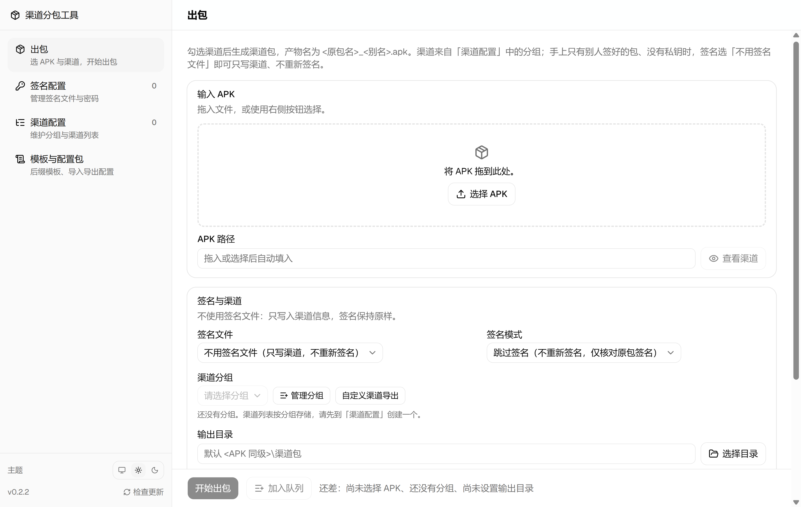
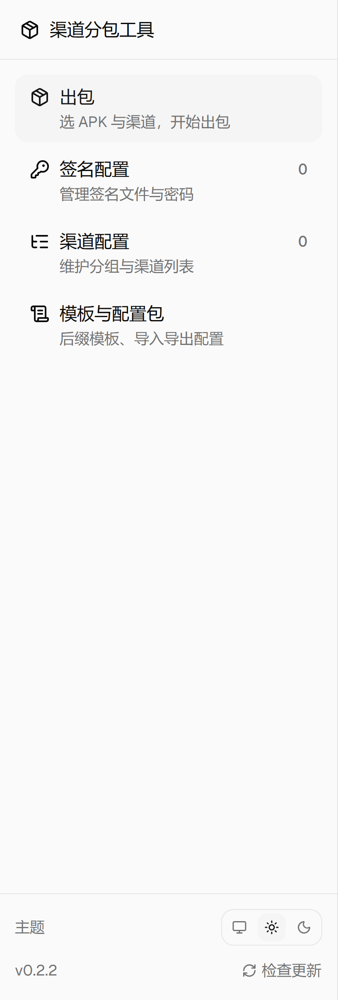

# Channel Packager

[中文](README.md) ｜ **English**

[](https://github.com/DHHHhhhe/channel-packager/releases)

[](LICENSE)

Drop in an APK, tick the channels you want, and get a batch of channel packages back.

No Java to install, no Android SDK to configure — the JRE, apksigner, zipalign and walle are all bundled.



> The UI is in Simplified Chinese. Button labels are quoted in Chinese below, with an English gloss in parentheses.

## Contents

- [What it does](#what-it-does)
- [Quick start](#quick-start)
- [The interface](#the-interface)
- [Channel lists belong to groups, not to keystores](#channel-lists-belong-to-groups-not-to-keystores)
- [Behaviour details](#behaviour-details)
- [Where the data lives](#where-the-data-lives)
- [Config packs](#config-packs)
- [Building from source](#building-from-source)
- [Releasing a new version](#releasing-a-new-version)
- [Known issues](#known-issues)
- [Third-party components](#third-party-components)
- [License](#license)

## What it does

| Capability | Notes |
| --- | --- |
| Batch channel packages | One APK in, a batch of channel packages out, named `<original name>_<alias>.apk` |
| Write channels without re-signing | Works when all you have is a package someone else signed and no private key |
| Channels organised in groups | One channel list per group, decoupled from keystores, several can coexist; add channels from a template |
| Passwords stored per keystore | Each keystore's password is kept separately, editable in the UI, with an eye button to check the plaintext |
| No local toolchain | The JRE, apksigner, zipalign and walle are all bundled — no Java to install, no Android SDK to configure |
| Portable configuration | Export a config pack (optionally without credentials) to move machines or sync a team in a single step |
| Failures you can act on | The result card names the failing step, its exit code and the tail of its output, plus a full log |
| Auto-update | Installed builds check for updates automatically; the release notes are shown first and you decide whether to download |

## Quick start

1. Grab channel-packager-setup-&lt;version&gt;.exe from [Releases](https://github.com/DHHHhhhe/channel-packager/releases) and install it (you can choose the install directory)
2. Open the app and go to the "签名配置" (Signing) page to add a keystore: pick the `.jks` file, confirm the alias and passwords, then click "新增并校验" (Add and verify)
3. Go to "渠道配置" (Channels), create a group and maintain its channel list; the "模板与配置包" (Templates & Config Packs) page holds the suffix templates you can apply when adding a keystore
4. Go to "出包" (Pack), drop the APK in, tick the channels, and click "开始出包" (Start packing)

> The first launch trips Windows SmartScreen (the exe has no code-signing certificate, so the publisher shows as "Unknown publisher"). Click "More info" → "Run anyway" — the file is not corrupt.

Installed builds **check for updates automatically**: when a new version is found the release notes are shown first and you decide whether to download; once downloaded you can restart immediately or let it install when you next close the window.

> The portable build (渠道分包工具-&lt;version&gt;.exe) and the unzip-and-run build have no auto-update — you replace those by hand. Neither is in the repository; build them yourself (see [Building from source](#building-from-source)).

## The interface



Four pages in the sidebar:

| Page | Purpose |
| --- | --- |
| 出包 (Pack) | Pick an APK and channels, start packing |
| 签名配置 (Signing) | Manage keystores and passwords |
| 渠道配置 (Channels) | Maintain groups and their channel lists |
| 模板与配置包 (Templates & Config Packs) | Suffix templates, import/export config |

The number on the right of a nav item is the item count for that page (keystores, groups); the bottom of the sidebar holds the theme switch, the update check and the current version.

## Channel lists belong to groups, not to keystores

One group = one channel list, independent of whether you have a private key:

- One app can have several groups ("production", "testing")
- The same channel list can serve different keystores
- Picking a keystore only decides how to sign

If all you have is a package someone else already signed and no private key, set the signing file to "不用签名文件" (No keystore) — it writes channels without re-signing.

## Behaviour details

<details>
<summary>Expand: per-page behaviour and edge cases</summary>

| Where | Action | Notes |
| --- | --- | --- |
| Signing → add keystore | Eye button next to the password | Toggles plaintext/masked, for checking a hand-copied password |
| Signing → add keystore | "渠道数据" (Channel data) block | Enabled once a `.jks` file is picked. Whichever you choose — no template / apply template / import JSON — the list below always shows **what will actually be saved**, and you can add, edit, delete rows, or tick several and delete them at once; the keystore and its channels are created together. "Import JSON" first opens an editable preview, and nothing lands in the list until you confirm |
| Signing → add keystore | When verification fails | The dialog stays open and nothing you typed is lost; only the offending field is highlighted (`.jks` file / alias / password) and the highlight clears as soon as you change it. A failed "Add and verify" removes the entry, the keystore copy and the channel file together — no half-written leftovers |
| Channels / Templates | Tick rows → "删除选中" (Delete selected) | The header is a select-all; deleting many at once is supported. While the list is filtered, select-all only affects the **visible** rows |
| Channels / Templates / add keystore | Search box and "排序方式" (Sort by) above the list | Filter by channel id or alias (case-insensitive); sort by either, with Chinese sorted by pinyin and digits inside channel ids numerically, and empty aliases sinking to the bottom. **Search and sort only change what is displayed** — saving and exporting always write the whole list; the counter becomes "showing X / N total". If a save is rejected (say an empty channel name), the filter is cleared automatically so the offending row cannot hide behind it |
| Channels | "导入 JSON" (Import JSON) | Opens an editable preview: the rows are the file's contents and you can add, edit or delete them. Choose **overwrite** (default, replace the whole list) or **append** (add to the end, skipping duplicates). Confirming only fills the page — **nothing is written to disk**; it behaves exactly like typing the rows in, so an import can never discard unsaved edits |
| Channels | "导出 JSON" (Export JSON) | Exports what is **on screen** (including unsaved edits), not what is on disk |
| Channels | "导出示例 JSON" when the list is empty | Gives you an editable starting point built from the templates page plus the current prefix; edit it and read it back with "Import JSON" |
| Channels | "按模板生成" (Generate from template) | Replaces the whole list, so if there are unsaved edits it asks first; cancelling leaves the list untouched |
| Channels | "渠道前缀" (Channel prefix) | **Has no default** — fill in whatever this batch needs. It only records the prefix and **does not touch the list**; the list is recomputed when you click "Generate from template", which again asks first if you have hand-edited rows |
| Pack | "自定义渠道导出" (Custom channel export) | Build a one-off channel list for this pack: import a channel JSON or type channel ids directly (one per line, alias optional). **Nothing is persisted** by default — only rows you tick "存入分组" (Save into group) are appended to the chosen group |
| Pack | "查看渠道" (View channels) | Shows the channel ids inside the package; if none were ever written it reports this explicitly instead of mistaking a file path for a channel id |
| Pack | Result card on failure | Names **which step failed, the exit code, and the last 15 lines of that step's output** — no digging through logs. The neighbouring "复制诊断信息" (Copy diagnostics) button copies it all, with the home directory rewritten to `%USERPROFILE%` so it is safe to paste to someone else |
| Pack | "跳过签名" (Skip signing) | When re-signing, a &lt;original name&gt;_已签名_未写渠道.apk is left next to the original. Use that file later with signing mode set to "Skip signing" to save the zipalign + apksigner pass. Before packing, the signature certificate of that file is compared against the selected keystore and the run aborts on a mismatch — otherwise you would ship a batch whose signatures do not match, and only find out at install or update time |
| Pack | "不用签名文件" (No keystore) | For when you only have a package someone else signed: writes channels without re-signing. Needs no keystore at all, and before packing it confirms the input can actually be skipped (an unreadable certificate, or no v2 signature, stops it). Afterwards every output is checked against the input's certificate and flagged on a mismatch |
| Pack | `.work/` in the output directory | Each "Start packing" wipes the previous `.work/` so it cannot grow forever; on failure it is kept so you can inspect the intermediate files |
| Pack | Hung subprocess | If zipalign / apksigner / walle produces **no output for 10 minutes** it is treated as stuck, killed, and the card states this — the UI does not hang indefinitely |
| Pack | "打开输出目录" / "打开日志" on the result card | Opens the output directory in Explorer; the log line opens in the system default program. If the path was moved or deleted it reports this explicitly instead of raising a system error dialog |
| Pack | "重跑本次" (Re-run this) on the result card | Puts the previous run's parameters (APK, keystore, ticked channels, signing mode, output directory) **back into the form** without starting — useful when you need to swap a few channels and run again |
| Pack | "加入队列" / "开始队列" (Add to queue / Start queue) | Collect several sets (different APKs, keystores, channels) and run them together. They run **serially**; a failing item is flagged on its own and does not stop the rest. Per-item status lives in the queue card, and "详情" (Details) shows that item's result card. "Add to queue" only records the current form's parameters; "Start queue" is what actually packs |
| Templates | Ticking "导出时不带签名凭据" (Export without credentials) | The pack then holds only the channel templates and an empty keystore list — no private keys, no passwords, no groups or channel lists. Importing it leaves the recipient's own keystores and groups untouched; they add a keystore and apply the templates |
| Data location | `data/logs/` | Keeps at most 30 files and 50 MB total, dropping the oldest first, always keeping at least the 10 most recent |
| Data location | When a config file is corrupted | A banner names **which file, why it could not be read, and its absolute path**, saves the broken content as &lt;name&gt;.broken, then continues with an empty list — **the original file is not modified at all**. Fix or delete it and reopen; "知道了" (Got it) dismisses the banner (it comes back if another file turns out to be broken) |

</details>

## Where the data lives

**Installed builds** keep their data in `%LOCALAPPDATA%\渠道分包工具\data`, separate from the install directory — uninstalling does not delete it.

**Portable / unzip-and-run builds** are a single exe that self-extracts to `%TEMP%` on each launch, but the data directory is pinned next to the exe:

```
渠道分包工具-<version>.exe
data/
├── jks.json                # alias and passwords for each keystore
├── groups.json             # group index: group name, Chinese app name
├── template.json           # channel suffix templates
├── keystores/<id>.jks      # keystore copies; signing and verification only use these
├── channels/<group id>.json # channel list per group
├── logs/                   # full log of every pack (rotated, never grows forever)
└── .runtime/               # Chromium cache, safe to delete
```

Copying the whole folder migrates everything; copying only the exe gives you a clean tool (no certificates, no channels).

`groups.json` is the index of the channel files — it and `channels/` must stay paired, or those channel files have no owner (config-pack import pairs them the same way). When upgrading from an older version, the channel lists that used to hang off each keystore are adopted as a group of the same name, and the old "English app name" is merged into the Chinese one; the process is idempotent and does not create duplicates on repeated launches.

If one of these `.json` files gets corrupted (a missing brace from hand-editing, power loss mid-write), a banner on startup names the file, the reason and the absolute path, saves the broken content as &lt;name&gt;.broken, then continues with an empty list — **the original file is not modified at all**. Fix it or delete it and reopen. Note that "file missing" and "file broken" are different things: the former is a normal "not configured yet" and does not warn; only an unreadable file is a problem.

Adding a keystore copies it into `data/keystores/`, and signing only ever uses that copy — moving or deleting the original `.jks` afterwards does not affect packing. Deleting a keystore **does not** touch any group or channel list: the two are decoupled.

> ⚠️ **Do not double-click a freshly built exe inside `app/release/`.** The data directory follows the exe, so it will create `release/data/` right there in the build output — containing keystore copies and plaintext passwords — and that whole directory is deleted whenever `release/` is rebuilt or cleaned, and swept along when you zip things up to share. Put the exe and `data/` together somewhere outside the repository (say `Desktop\渠道分包工具\`) and run it from there. The build script has a guard: detecting `app/release/data/` aborts the build with an explanation.

## Config packs

> A config pack contains **plaintext passwords and private keys**. Only send it to people you trust; importing one installs someone else's signing identity on your machine.

| What you send | Contents | Use case |
| --- | --- | --- |
| The installer | A clean tool, no certificates or channels | Give a colleague the tool |
| A config pack | Keystore copies + credentials + groups and channel lists + templates, zipped | Migrate to another machine, keep a team's setup in sync |
| A config pack with "不含签名凭据" ticked | Templates + an empty keystore list, zipped | Give a colleague the channel templates and let them add their own keystores |

Before importing, the manifest and the SHA256 of every file are verified and conflicts are listed; conflict handling can **skip**, **keep both** (the new entry is renamed &lt;id&gt;_2) or **overwrite**.

Groups and channel lists travel in the pack's `groups.json` + `channels/`. **Packs exported by older versions (only `channels/`, no `groups.json`) still import** — they are restored as "one group per keystore with the same name", and the old "English app name" field is merged into the Chinese one. The pack format version did not change, so old and new exes interoperate.

To export a single channel list, use "导出 JSON" / "导出示例 JSON" on the Channels page — those contain only channel ids and aliases.

## Building from source

### Prerequisites

| Dependency | Notes |
| --- | --- |
| Node.js ≥ 20 | Developed and verified on Node v24 |
| pnpm 11 | `packageManager` pins 11.8.0 |
| PowerShell 7 | Used by the runtime preparation and icon scripts |
| Android SDK build-tools | Optional. Only used to source `zipalign.exe` and `apksigner.jar`; without an SDK the two copies already in the repository are used |
| Network | `prepare:runtime` downloads Temurin JDK 17 from Adoptium (~182 MB) |

### Steps

```powershell
git clone https://github.com/DHHHhhhe/channel-packager.git
cd channel-packager/app

pnpm install
pnpm prepare:runtime   # generates resources/bin — not in the repo, must be run once
pnpm dev               # development mode
pnpm build             # type-check + bundle the renderer
```

To produce the installer / portable build (output lands in `app/release/`):

```powershell
.\node_modules\.bin\electron-builder.CMD --win nsis portable zip
```

> `pnpm dist` does not work on some setups — see [Known issues](#local-pnpm-dist-fails-with-unknown-argument-electron-builderclijs).

`app/resources/bin/` is mostly not in the repository (33.4 MB; only `zipalign.exe` and `apksigner.jar`, about 2.0 MB, ship with it) and is rebuilt by `pnpm prepare:runtime`:

| Artifact | Source |
| --- | --- |
| `jre/` | Temurin JDK 17 downloaded from Adoptium and trimmed with `jlink` (module set `java.base,java.sql,java.logging,jdk.crypto.ec,jdk.jartool`) |
| `zipalign.exe`, `apksigner.jar` | The highest-numbered stable directory in the local Android SDK build-tools; without an SDK, the two copies already in the repository (which is why the build works without one) |
| `walle-cli-all.jar` | Repository root (a third-party build, see [Third-party components](#third-party-components)) |

The script is idempotent: if an artifact exists and its size matches `resources/bin/.manifest.json`, it is skipped. Pass `-Force` to rebuild.

## Releasing a new version

Push a v&lt;version&gt; tag and GitHub Actions builds on Windows and uploads the **installer + `.blockmap` + `latest.yml`** to Releases. No local Node / Android SDK and no token needed.

```powershell
# 1. Bump app/package.json's version (must be greater than the released one; the same number will not upgrade)
# 2. Write what this release says into app/build/release-notes.md — it becomes the Release body,
#    and the update notes the client shows when it finds a new version
# 3. Commit and push, then:
git tag v0.3.0
git push origin main --tags
```

The Release comes out as a **published** release (which is what the client accepts), and machines running an older version upgrade themselves next time the app opens. To stage it as a draft instead and publish by hand: add `EP_DRAFT=true` under Settings → Secrets and variables → Actions → Variables, or tick `draft` when triggering the workflow manually.

### Releasing from your own machine

```powershell
git remote add origin https://github.com/<account>/<repo>.git   # once
$env:GH_TOKEN = 'ghp_xxx'                                       # public_repo for a public repo, repo for a private one
pwsh -File app/scripts/release.ps1
```

The script reads the account and repository from `origin` (the two values in `electron-builder.yml` are placeholders and must be overridden on a build machine, otherwise the build fails outright), runs `pnpm build`, then builds and uploads with `electron-builder --win nsis --publish always`. The Release is created as a **draft** — publish it on the web before anyone else can see it.

| Route | Good for | Requires |
| --- | --- | --- |
| GitHub Actions | Releasing from another machine, or for collaborators | The repository is already on GitHub |
| `app/scripts/release.ps1` | You have a build environment and want it now | Node / pnpm installed, `GH_TOKEN` configured |

Both routes upload only the **installer** (the only artifact with auto-update); the portable and unzip-and-run builds stay in your local `app/release/` — upload those by hand if you need them.

### About the update URL

- An installed build has the update URL baked into the installer's `resources/app-update.yml`, so **changing the URL means rebuilding the installer**
- To change it without repackaging, drop an `update.json` into the data directory (`{"url":"http://intranet-server/channel-packager/"}`) — the app uses it to override the built-in URL at startup

## Known issues

### Windows blocks the first launch

The installer has no code-signing certificate, so SmartScreen shows "Windows protected your PC" with an unknown publisher. The file is not corrupt — click "More info" → "Run anyway".

If you only see "Don't run" and "More info", "Run anyway" is folded behind "More info" — open it and it is there. Related prompts:

| Prompt | What to do |
| --- | --- |
| The browser warns about an uncommon or unsafe download | Choose "Keep" |
| Antivirus flags an unknown publisher and offers to block it | Allow it; this is the missing signature, not a virus detection |
| Right-click the installer → Properties shows an "Unblock" checkbox at the bottom | Tick it and confirm — one fewer prompt next time |

When handing the tool to someone, **send the installer only** — never the `data/` directory alongside it. It holds the **plaintext passwords** in `jks.json`, the private-key copies in `keystores/`, your groups and channel lists, and logs containing local paths. To share a channel table for reference, use "导出 JSON" / "导出示例 JSON" on the Channels page — those carry only channel ids and aliases.

### Local `pnpm dist` fails with `Unknown argument: …electron-builder\cli.js`

pnpm rewrites `node` inside script bodies to the Node it is itself running on. If pnpm is running inside Electron (say the pnpm bundled with a desktop app), that rewrite points at the host exe, so `node cli.js` inside `.bin/electron-builder.CMD` becomes `host.exe cli.js`.

Work around it with:

```powershell
cd app
.\node_modules\.bin\electron-builder.CMD --win portable
```

Under a normal Node installation `pnpm dist` works fine.

### App icon

`app/build/icon.ico` is generated by `app/scripts/make-icon.ps1` (a multi-size PNG container). Change the colours or shape and rerun the script — there is no external design source to keep in sync.

```powershell
cd app
pwsh -NoProfile -File scripts/make-icon.ps1
```

### The sample config is sanitised

Every channel id in `channelConfig.sample.json` has been rewritten (prefix `demo_`) and it exists only to demonstrate the file structure — it has a single field, `channelInfoList`. Maintain your real config yourself and do not commit it.

Only `channelInfoList` is read on import; if an older version's `defaultExtraInfo` is still in the file it is **ignored outright** (the tool no longer writes extra information into packages, and anything written there is metadata nobody reads).

The repository's `.gitignore` already excludes `*.jks`, `*.keystore`, `*.apk`, `data/` and `channelConfig.json`.

### There is no exe in the repository

`app/release/` is in `.gitignore`, so a fresh clone contains **no exe at all** — run a build yourself (see [Building from source](#building-from-source)). The output is app/release/渠道分包工具-&lt;version&gt;.exe, about 120 MB.

It is kept out of version control because it is a build artifact: hundreds of megabytes, and byte-different on every build (timestamps, signatures), so committing it would only bloat the repository.

**Code changes need a rebuild to reach the exe.** `pnpm build` only updates `dist/` and `dist-electron/` (used in development); the packaged build stays on the previous version — launching from `app/release/` still runs the old logic.

## Third-party components

| Component | Version | License |
| --- | --- | --- |
| Electron | 44.4.5 | MIT |
| Chromium | ships with Electron | BSD-3-Clause and others |
| Temurin JRE | 17.0.20.1 | GPLv2 + Classpath Exception |
| apksigner | 0.9 | Apache-2.0 |
| zipalign | Android SDK build-tools | Apache-2.0 |
| Walle | 1.1.6 (third-party build, see below) | Apache-2.0 |

### Where the Walle CLI jar comes from

The `walle-cli-all.jar` in the repository root is **not an upstream release asset — it is a third-party build**. Its provenance is below; read it before relying on it.

| Item | Value |
| --- | --- |
| Upstream project | [Meituan-Dianping/walle](https://github.com/Meituan-Dianping/walle) (Apache-2.0) |
| This copy | 585,426 bytes, SHA256 `89D0358A512B7AC0586F999B31774C6A4B76A388AC35A34B1F28169FA449368B` |
| Obtained from | A self-compiled build posted by user `vclub` in [issue #264](https://github.com/Meituan-Dianping/walle/issues/264): `https://github.com/vclub/vclub.github.io/raw/master/walle-cli-all.jar` |
| Code it corresponds to | Upstream master after PR #259 (commit `be6421b`); the manifest reports `Walle-Version: 1.1.6` |
| Bundled dependencies | jcommander 1.48, commons-io 2.5, org.json 20080701, gson 2.8.0 |

**Why not the official release asset**: upstream only ever published the `v1.1.6` `walle-cli-all.jar` (584,848 bytes, SHA256 `E655C5284EE1FC2916CCCA2ED3217C4BE227A8284FDB9218308C9CF431EF222C`), which lacks the signing-block verity padding fix from PR #259 and produces packages that will not install — see [issue #290](https://github.com/Meituan-Dianping/walle/issues/290):

```
INSTALL_PARSE_FAILED_NO_CERTIFICATES ... using APK Signature Scheme v3:
Size of APK Signing Block is not a multiple of 4096: 4127
```

Upstream `v1.1.7` published no assets at all ([issue #334](https://github.com/Meituan-Dianping/walle/issues/334) is asking about exactly that), and the upstream Gradle build no longer works (wrapper 2.14.1, jcenter shut down).

**Risk note**: this jar comes from a personal GitHub Pages repository and cannot be tied to a specific upstream commit; the link has gone dead once already. For a reproducible build, compile it yourself from a pinned upstream commit — the sources of `walle-cli`, `payload_writer` and `payload_reader` compile with `javac --release 8`, then merge them with the third-party dependencies from the official jar into a fat jar. No Gradle needed.

## License

[MIT](LICENSE)
